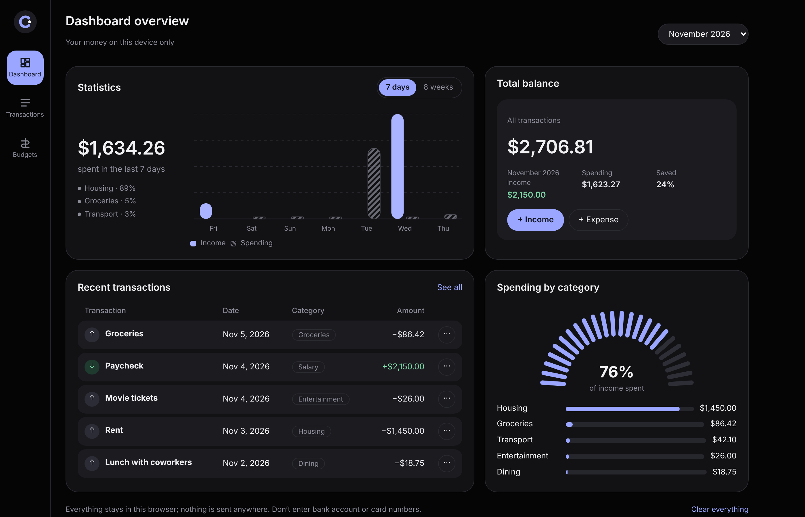
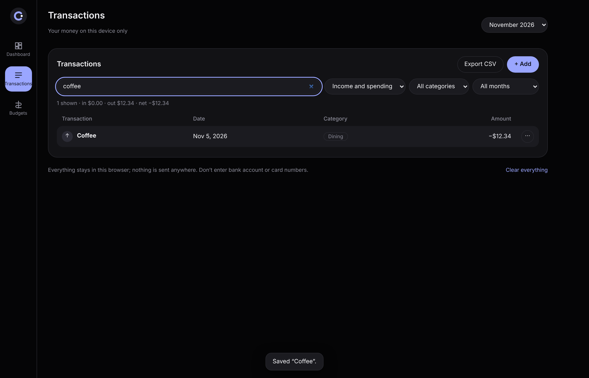
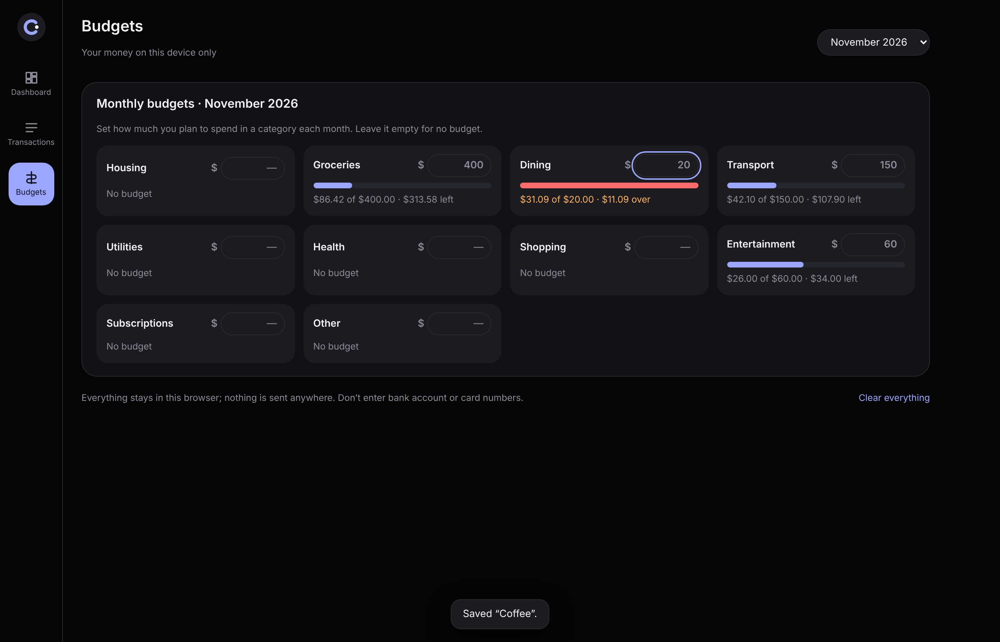
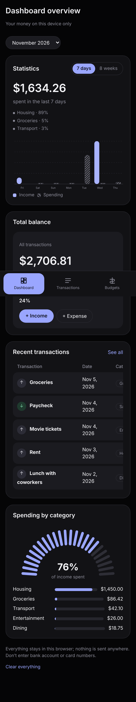

# Cashflow

**▶ [Live demo](https://theoyanvno.github.io/finance-tracker/)**

A personal finance tracker built with React. Add your income and spending, and see your balance, how much of this month's income you've spent, statistics for the last 7 days or 8 weeks, spending by category and monthly budgets. Everything stays in your own browser: nothing is sent anywhere, and there's no bank connection.



| Transactions | Budgets | Phone |
|---|---|---|
|  |  |  |

*The first visit shows an example month you can clear with one click.*

## Features

- **Dashboard:** total balance, this month's income, spending and savings rate, a bar chart of income and spending for the last **7 days** or **8 weeks**, recent transactions, and a gauge of how much of the month's income is spent, with the top categories
- **Transactions:** add, edit and delete income and expenses, with categories and notes; search and filter by type, category and month, with the totals of what's shown; **Export CSV** for a spreadsheet
- **Budgets:** a monthly limit for any spending category, with how much is used and left, turning amber near the limit and red over it
- **Month picker** for any month you have transactions in
- Works on phones (the side menu becomes a bottom bar) and from the keyboard; the add and edit form is a real dialog, and wrong amounts or missing details are explained

**Tech:** React 19 · JavaScript (ES modules) · CSS grid · SVG charts · `<dialog>` · `localStorage` · esbuild · `node:test`

## How it works

- **Money is whole cents.** Every amount is stored as an integer number of cents and only formatted as dollars on screen, so `0.10 + 0.20` is exactly `0.30` and totals never drift. Typed amounts like `$1,234.5` are read carefully, and anything that isn't an amount is refused.
- **All the rules live in [`src/lib/money.js`](src/lib/money.js), with no React:** checking a transaction, totals and savings rate, spending by category, the daily and Monday-to-Sunday weekly series, budget use, filters and the CSV export. They're tested in Node.
- **Safe CSV:** every text field is quoted, and a description starting with `=`, `+`, `-` or `@` gets a leading `'`, so a spreadsheet won't run it as a formula.
- **Safe saving:** saved data is read back one transaction at a time and anything broken is skipped, so one bad entry can't lose the rest. If the browser blocks storage, the app says so.
- **Charts are plain SVG** with the same numbers in a hidden table for screen readers.

## Run it

```
npm install
npm start        # builds and serves at http://localhost:8000, rebuilding on every change
npm test         # node --test
npm run build    # writes the site to docs/, which GitHub Pages serves
```

| Path | What's in it |
|---|---|
| `src/App.jsx` | The page: navigation, saving, the month picker, export and clearing |
| `src/components/` | The dashboard, transactions and budgets pages, the charts and the transaction form |
| `src/lib/money.js` | Every money rule (no React; tested) |
| `public/` | The HTML page, styles and icon |
| `build.mjs` | Bundles the app with esbuild into `docs/` |

This is a personal budgeting tool, not financial advice. Don't enter bank account or card numbers.

Built with help from AI coding tools for planning, code review and tests.

## License

MIT, see [LICENSE](LICENSE).
